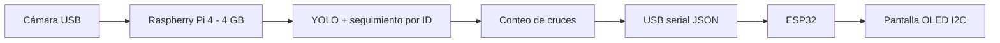

# Sistema inteligente para conteo de pasajeros en un bus
**Asignatura:** Sistemas Inteligentes para Electrónica · **Modalidad:** ABPr

## Informe académico del proyecto ABPr
Corte 2 — Avance 2
[Consultar informe completo del ABPr](https://github.com/matius5/Conteo-inteligente-de-pasajeros/blob/main/documentacion/ABPr_Avance_2.md)


> **Estado:** prototipo de visión artificial probado previamente en un computador, según los avances reportados por el equipo. Este repositorio contiene una **implementación de referencia nueva** y no sustituye el código exacto que ya desarrollaron. Raspberry Pi, ESP32 y pantalla OLED requieren integración y pruebas físicas.

## 1. Problema
Determinar el número de personas que ingresan y salen de un bus mediante una cámara situada en la zona de acceso, evitando contar repetidamente a la misma persona.

## 2. Objetivo
Detectar y seguir personas, identificar cruces de una línea virtual y calcular la ocupación estimada, mostrando el resultado en una pantalla conectada a una ESP32.

## 3. Arquitectura propuesta


## 4. Hardware
- Raspberry Pi 4 (4 GB) como candidato de procesamiento (aún por validar rendimiento).
- Cámara USB, modelo por confirmar.
- ESP32, placa exacta y mapeo de pines pendientes de confirmar.
- Pantalla OLED I2C; controlador y dirección I2C pendientes de verificar.
- Fuente(s) de alimentación y cableado adecuados.

### Diferencia entre el avance original y este código de referencia

El equipo reportó una **prueba inicial de detección en el portátil con YOLOv8**. El archivo `codigo/conteo_yolo.py` incluido aquí es una **implementación de referencia posterior**, cuya configuración por defecto usa `yolo11n.pt` y una **línea horizontal** (`--line-y`). Por su parte, el informe ABPr describe como propuesta una **línea vertical** (`linea_x`).

Esto no debe interpretarse como pruebas completadas con ambos modelos ni como evidencia de que ambas orientaciones funcionen: antes de integrar el sistema debe seleccionarse la orientación según la cámara real y validar el conteo. El modelo del código se puede cambiar mediante `--model yolov8n.pt`, y la orientación de la línea se configura por separado mediante `--line-x` o `--line-y`.

Para evitar inconsistencias, se conserva el informe académico como documento del avance y se identifica este programa explícitamente como referencia sin validación experimental.

## 5. Algoritmo
1. Capturar fotogramas con OpenCV.
2. Detectar personas con un modelo YOLO preentrenado.
3. Seguir cada persona por identificador para comparar su posición entre fotogramas.
4. Registrar el cruce de una línea horizontal (por defecto) o vertical (`--line-x`); sumar entrada o salida según la dirección calibrada.
5. Estimar la ocupación con el conteo de entradas y salidas (el prototipo aplica `max(0, entradas - salidas)`); registrar también una ocupación inicial cuando se valide en el autobús. Enviar eventos por puerto serial a la ESP32 si esta está conectada.

**Importante:** el prototipo permite configurar una línea horizontal o vertical. Una línea horizontal supone que el movimiento relevante ocurre verticalmente en la imagen. La orientación entrada/salida debe verificarse con videos reales. Oclusiones, cambios de ID y embarque simultáneo pueden provocar errores.

## 6. Organización
- [`codigo/conteo_yolo.py`](codigo/conteo_yolo.py): prototipo de seguimiento y conteo 
- [`codigo/enviar_serial.py`](codigo/enviar_serial.py): emisor opcional de mensajes JSON a ESP32.
- [`codigo/esp32_oled/esp32_oled.ino`](codigo/esp32_oled/esp32_oled.ino): ejemplo Arduino ESP32 OLED, sujeto a confirmar pantalla y pines.
- [`documentacion/avances.md`](documentacion/avances.md): bitácora de avances.
- [`hardware/`](hardware/): lugar reservado para esquemático y PCB KiCad reales.
- [`evidencias/`](evidencias/): fotografías, videos y capturas.

## 7. Ejecución en PC (prototipo)
```bash
python -m venv .venv
# Windows: .venv\Scripts\activate
# Linux/macOS: source .venv/bin/activate
pip install -r requirements.txt
python codigo/conteo_yolo.py --camera 0 --line-y 250
# Alternativa con línea vertical:
# python codigo/conteo_yolo.py --camera 0 --line-x 320
```
El primer arranque puede requerir descargar el modelo `yolo11n.pt` desde Ultralytics. Para emitir datos por serial, agrega `--serial-port COM3` (ajusta puerto según el equipo). No ejecutes código de ESP32 hasta revisar pines, pantalla, librerías y alimentación.

## 8. Evidencias y trazabilidad

- [Informe ABPr completo — Corte 2, Avance 2](documentacion/ABPr_Avance_2.md)
- [Bitácora de avances](documentacion/avances.md)
- [Guía para añadir evidencias reales](documentacion/GUIA_EVIDENCIAS.md)
- [Aclaración de versiones de YOLO y orientación de la línea](documentacion/COMPATIBILIDAD_MODELOS.md)

Las imágenes del esquemático, PCB o funcionamiento del sistema solo se publicarán como resultados una vez que el equipo las haya producido y verificado.

## 9. Evidencias que faltan por subir
- [ ] Código original YOLO desarrollado por el equipo.
- [ ] Capturas y video de prueba en la cámara del computador.
- [ ] Pruebas de conteo de entrada/salida y tasa de error.
- [ ] Prueba del sistema en Raspberry Pi 4.
- [ ] Capturas o fotos de pantalla OLED con ocupación.
- [ ] Esquemático y PCB KiCad verificables.

## 10. Consideraciones
....

## 11. Resultados y conclusiones
**Pendientes de medición y documentación.** No se atribuyen métricas sin evidencia.

